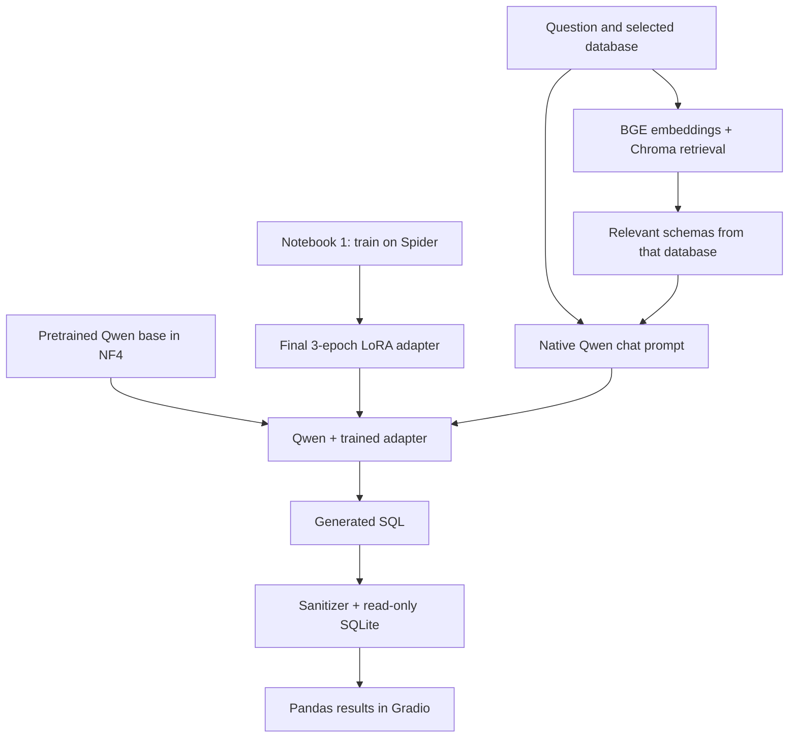

# Ask Spider: Gradio app

Open [the app notebook on Kaggle](https://www.kaggle.com/code/yettouabdallah/qlora-schema-rag-gradio).
The self-contained local upload file is
[gradio_text2sql.ipynb](kaggle_gradio_kernel/gradio_text2sql.ipynb).

## How Notebook 1 connects to Notebook 2

Notebook 1 trained LoRA matrices on Spider question-to-SQL examples. It saved the
final adapter, not a second full copy of Qwen. Notebook 2 loads the pretrained
Qwen base in NF4 and attaches these learned matrices with `PeftModel.from_pretrained`.
That combined model reads the question and generates the SQL.



BGE is a separate small embedding model. It retrieves schema documents; it does
not generate SQL. Qwen receives the question plus retrieved table/column/key
definitions, with the Notebook 1 adapter active. Asking a new question does not
perform another training step. Schema retrieval does not modify adapter weights.

## Running the app

1. Open the Kaggle app notebook in an **interactive editing session**.
2. Enable a **Tesla T4 GPU** and **Internet**.
3. In its first code cell, change `LAUNCH_APP = False` to `LAUNCH_APP = True`.
4. Run all cells. Setup downloads the base model and loads the attached adapter;
   subsequent questions reuse that loaded model.
5. When prompted, choose a temporary app password. Do not enter a Kaggle token or
   a Kaggle account password. The app username is **demo**.
6. Open the printed Gradio share URL in a new browser tab and log in.
7. Select `concert_singer`, click **How many singers are there?**, then click
   **Generate SQL and run**.

Keep the interactive Kaggle session running while using the app. Saving a batch
version verifies the app and exits; a completed batch notebook is not a running
web server. If setup has already finished in a live session, run this cell:

```python
launch_app(demo)
```

The share link requires the live backend and is temporary. Authentication is
provided by Gradio's `auth` option; see the
[official sharing guide](https://gradio.app/guides/sharing-your-app).

## Inputs already attached

- `yettouabdallah/qlora-text2sql-3epochs`: final adapter and tokenizer.
- `yousufqureshi5/spider-sqlite-databases`: SQLite databases and DDL.
- `yettouabdallah/qlora-schema-aware-rag-sql`: completed benchmark outputs.

No separate adapter upload, Hugging Face repository, API key, or extra Python
file upload is required. The notebook includes its source modules.

## Interface

- **Ask the database:** database selector, question box, three ready-made example
  questions, generated SQL, query-result preview, retrieved schemas and timings.
- **Benchmark results:** saved 100-example comparison, including base 3%,
  schema-free 3-epoch 15%, and schema-aware 3-epoch 62% strict EX. The unmeasured
  60-step model remains labelled unmeasured.
- **How it works:** the connection between fine-tuning, retrieval and execution.

A live answer reports SQL execution success, not correctness or a confidence
percentage. New questions have no gold SQL. Review the generated query and result.
The app previews at most 1,000 rows, caps SQL results at 20,000 rows and uses a
five-second SQLite deadline. GPU requests are serialized; eight requests may wait
in the queue. A GPU-memory failure requires restarting the session.

## Verification

Kaggle version 1 reached **COMPLETE on November 13, 2026**. All three real model
queries passed both the value check and strict DataFrame equality. Request times
were 5.36 s (count), 4.22 s (GROUP BY), and 8.86 s (JOIN + GROUP BY). Sampled peak
GPU usage was **6,653,411,328 bytes (6.65 decimal GB)**. Error-handling checks and
the actual Gradio HTTP/API checks passed. The verification file records the source hashes of the tested version.

Evidence: [verification JSON](results_gradio/gradio_verification.json) and
[Kaggle execution log](results_gradio/qlora-schema-rag-gradio.log).
The batch verification server was closed after the tests. Use the manual launch
steps above to start an interactive app session.

The remote verification starts a loopback Gradio HTTP server on Kaggle and uses
the [Gradio Python client](https://gradio.app/docs/python-client/client) to call
the actual queued API. It checks three generated answers against reference SQL,
and checks empty questions, invalid database IDs, retrieval settings, mutation
rejection, multiple statements and missing-table errors. Reference SQL is used
only after generation and never passed into the live prompt.

Three-question value checks are smoke tests, not a new benchmark EX estimate.
The existing 62% score remains the strict 100-example result. All model, schema
embedding and SQL tests run remotely; local work only packages code and inspects
downloaded evidence.

```bash
python kaggle_gradio_kernel/build_kernel.py  # packaging only
kaggle kernels push -p kaggle_gradio_kernel --accelerator NvidiaTeslaT4 -t 3600
kaggle kernels status yettouabdallah/qlora-schema-rag-gradio
kaggle kernels output yettouabdallah/qlora-schema-rag-gradio -p results_gradio
```

Implementation: [app.py](gradio_app/app.py), [remote checks](gradio_app/verify.py),
[notebook builder](kaggle_gradio_kernel/build_kernel.py).
