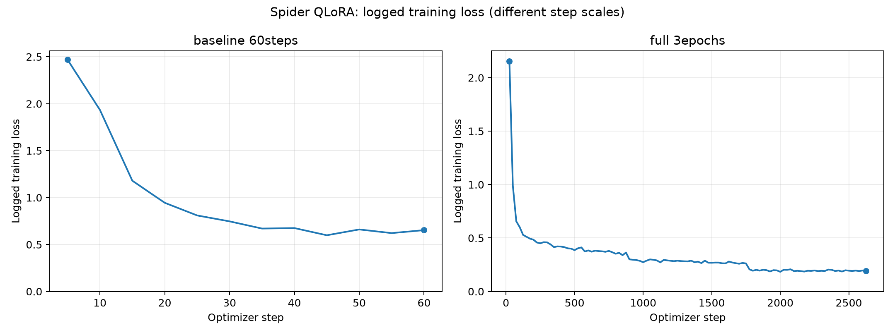

# Spider QLoRA comparison

**Follow-up:** a 100-example Kaggle evaluation comparing the unadapted base with
the final 3-epoch adapter is now complete. See the [verified benchmark results](KAGGLE_BENCHMARK.md).
The training-run comparison below retains the separate 60-step baseline.

Both Kaggle runs were checked on 2026-11-09 and reported `KernelWorkerStatus.COMPLETE`.
Their complete output downloads finished successfully, with no partial downloads remaining.

| Metric | 60-step baseline | Full 3 epochs |
|---|---:|---:|
| Optimizer steps | 60 | 2,625 |
| Epochs completed | 0.06857 | 3.0 |
| Training examples processed | 480 | 21,000 |
| Unique training examples available | 7,000 | 7,000 |
| First logged training loss | 2.469704 at step 5 | 2.152709 at step 25 |
| Last logged training loss | 0.653212 at step 60 | 0.191991 at step 2,625 |
| Reduction from first logged loss | 73.55% | 91.08% |
| Training wall time from log markers | 212.77 s / 3m 33s | 9,359.41 s / 2h 35m 59s |
| Last kernel log timestamp | 431.73 s / 7m 12s | 9,573.19 s / 2h 39m 33s |
| Peak allocated GPU memory | 5.97 GiB | 5.98 GiB |
| GPU used by training | 1 × Tesla T4 | 1 × Tesla T4 |
| Saved adapter parameters | 40,370,176 | 40,370,176 |
| Saved adapter precision | FP32 | FP32 |
| Adapter weights size | 161,533,192 bytes | 161,533,192 bytes |

The 21,000 examples are repeated exposures to 7,000 unique training records.
“First logged loss” is a window average, not a measurement at step zero. Logging
intervals differ (5 versus 25 steps). The full run also changes the warmup and
learning-rate schedule: 10 warmup steps and linear decay versus 3% warmup and
cosine decay. This comparison does not isolate the effect of epoch count alone.

Training wall time is the interval between the launch and completion messages,
including checkpoint work inside that interval. Kernel elapsed time is the final
log timestamp, including installation, loading, inference and notebook conversion;
it is not a scheduler/billing measurement. The T4 allocation exposed two GPUs,
but the logs say training used one. Memory comes from
`torch.cuda.max_memory_allocated() / 1024**3`, measured before inference; it is
not total driver memory, reserved memory, or memory on both GPUs combined.

## Loss convergence



The baseline reaches roughly 0.6–0.7 by its final steps. The full run continues
to 0.36415 at the end of epoch 1, 0.26205 at epoch 2, and 0.19199 at epoch 3.
The third epoch settles around 0.19–0.20. A lower training loss demonstrates
better fit to the training objective; it does not establish improved validation
accuracy or rule out overfitting. No validation loss was recorded.

The notebooks supply only database IDs and questions, despite a system prompt
that mentions schemas. They also do not explicitly configure assistant-only loss
masking. Schema-aware training and held-out execution evaluation are the next
experiments to run before choosing a model for deployment.

The complete curve contains 12 baseline and 105 full-run observations:
[CSV](./loss_curves.csv), [structured metrics](./training_metrics.json).
Regenerate both with [the extraction script](../scripts/compare_runs.py).

## Recorded inference across the three tiers

All prompts use `concert_singer`, without a supplied schema. The following SQL
comes directly from the execution logs, with whitespace formatted for readability.

### Simple Aggregate

Question: “How many singers do we have?”

Both models returned:

```sql
SELECT count(*) FROM singer
```

This matches the question and prepares successfully against the official schema.

### Multi-Table JOIN

Question: “What are the names of all singers who had a concert in 2020?”

The baseline did not run or record this test. The full model returned:

```sql
SELECT T3.Name
FROM concert AS T1
JOIN artist AS T2 ON T1.Artist_ID = T2.Artist_ID
JOIN singer AS T3 ON T2.Singer_ID = T3.Singer_ID
WHERE T1.Year = 2020
```

**Incorrect schema:** SQLite preparation fails with `no such table: artist`.
The official schema contains `stadium`, `singer`, `concert`, and
`singer_in_concert`. It has no `artist` table or `concert.Artist_ID` column.
[Official schema source](https://github.com/taoyds/spider/blob/master/evaluation_examples/examples/tables.json).

A schema-correct reference formulation is below; this is an analyst correction,
not a generated model output:

```sql
SELECT DISTINCT s.Name
FROM singer AS s
JOIN singer_in_concert AS sc ON sc.Singer_ID = s.Singer_ID
JOIN concert AS c ON c.concert_ID = sc.concert_ID
WHERE c.Year = 2020
```

The year-2020 question can produce an empty result on an actual database. Matching
empty results alone would not demonstrate that two queries are semantically equivalent.

### GROUP BY / HAVING

Question: “Show the country and number of singers for countries with more than 1 singer.”

The baseline did not run or record this test. The full model returned:

```sql
SELECT Country, COUNT(*)
FROM singer
GROUP BY Country
HAVING COUNT(*) > 1
```

This matches the question and prepares successfully against the official schema.

[Schema check results](./tier_schema_checks.json) were obtained using SQLite
`EXPLAIN` on an in-memory schema with no data. All three full-run answers parse
as SQL; only two prepare against the schema. These are qualitative/schema checks,
not measured Spider execution accuracy. There is no evidence for a baseline
versus full-model improvement on JOIN or GROUP BY/HAVING because the baseline
did not record those outputs.

## Adapter integrity and publishing

Both final exports match their respective final checkpoint weights byte-for-byte
by SHA-256. The baseline download also matches the previously saved local baseline.
The full export matches checkpoint 2625, not the retained checkpoint 1750.

The final full-run adapter is in
[lora_sql_adapter_3epochs](../results_3epochs/lora_sql_adapter_3epochs/).
Its weights occupy **161.53 MB / 154.05 MiB**, not approximately 50 MB.
The reason is 40,370,176 parameters stored as FP32. Even FP16/BF16 would require
approximately 80.74 MB for these parameters. Four-bit quantization of the frozen
base model does not imply four-bit saved LoRA weights.

Full adapter SHA-256:
`961d13a4c49a15b92e1a0801f72e86253f4c4f5f7665786e9e758fd6ad1f5a9a`.
See the [adapter manifest](./adapter_manifest.json).

The [publisher](../scripts/publish_adapter.py) validates the safetensors layout
and stages an explicit set of adapter/tokenizer files plus a generated model
card. Its default action is a dry run; an explicit repository ID and `--push`
are required for upload. No Hub upload has been performed. Merging would produce
a full base-plus-adapter model, rather than the small adapter-only deliverable.
[PEFT checkpoint documentation](https://huggingface.co/docs/peft/developer_guides/checkpoint).

## Validation status and evidence

The evaluator and publisher pass 16 CPU tests, including an end-to-end scoring
CLI test, alignment checks, duplicate/order handling, read-only enforcement,
timeouts, row limits, and rejection of truncated/full-model weight files.
The publisher's dry run passed on both downloaded final adapters.

This training-log comparison did not measure validation execution accuracy.
The subsequent [100-example Kaggle benchmark](KAGGLE_BENCHMARK.md) now supplies
measured scores for the unadapted base versus the final adapter, with downloaded
SQLite databases and independent local rescoring. Evaluation over the entire
Spider validation split and comparison against the 60-step adapter remain separate
experiments. Follow [the run guide](../EVALUATION.md) to reproduce either workflow.

Source artifacts:

- [Baseline kernel](https://www.kaggle.com/code/yettouabdallah/qlora-text2sql-qwen2-5-coder), [downloaded log](../results_baseline/qlora-text2sql-qwen2-5-coder.log), [trainer state](../results_baseline/outputs_qlora_sql/checkpoint-60/trainer_state.json).
- [Full kernel](https://www.kaggle.com/code/yettouabdallah/qlora-text2sql-3epochs), [downloaded log](../results_3epochs/qlora-text2sql-3epochs.log), [trainer state](../results_3epochs/outputs_qlora_sql_3epochs/checkpoint-2625/trainer_state.json).

The embedded Kaggle credential was removed from both local training notebooks.
Rotate the exposed token and remove it from any published notebook versions;
local source cleanup does not revoke a credential or erase remote history.
